# Momentum | Behind the Build

**The engineering, evidence and industrial reasoning behind a supervised AI production-preparation system.**  
**Team Nucleas · AI Builder Cup 2026 · JAPAC**  
**Team Lead:** Siddhant Oswal · Cloud, AI agent and application engineering  
**Team Member:** Om Jain · Corrugated-plant operations, production data and models  
**Problem statement:** Manufacturing: Intelligent Operations & Industrial Efficiency  
**Submission category:** Sustainability  
**Status:** Working supervised prototype. Some outputs are modeled; measured plant savings and predictive factory accuracy have not been established.

> **The premise:** Before a manufacturing run starts, operators make a collection of decisions that influence material use, conversion cost, quality and practical feasibility. Momentum prepares those decisions for review using confirmed order data, bounded numerical comparisons and explainable AI-assisted recommendations. It does not operate machinery.

**Explore:** [Live Momentum application](https://momentum-514663464609.asia-south1.run.app/) · [Public GitHub repository](https://github.com/SiddhantOswal/Momentum) · [Source and local setup](https://github.com/SiddhantOswal/Momentum/blob/main/docs/README.md) · [Optional project feedback](https://forms.gle/4NWFdb8USJopqPwV7)

---

## Start here: Momentum in two minutes

Momentum is an AI-assisted production-intelligence prototype focused initially on **corrugated packaging manufacturing**. It starts with an approved purchase order (PO). Gemini helps extract order information, the application resolves and validates the relevant catalog entry, and an operator confirms conditions and planned settings. Five BigQuery ML models estimate defect-related risks. A constrained search compares permissible machine-setting alternatives using modeled quality and cost information. Gemini helps explain the supplied evidence. The resulting recommendation is saved as a **DRAFT**; an authorized supervisor must review and approve it before the approved PDF job card can be retrieved.

The business rationale is simple. **Selling an order does not guarantee that it is produced at the intended margin.** A box can be sellable and still cost more to make than planned because of material overuse, settings, changeovers or other inefficiencies. Momentum targets better pre-run decision support, not merely scrap detection. The current measured technical success is the functioning preparation-and-approval workflow; reductions in actual factory cost remain to be proven with real production outcomes.

### One complete journey

**Approved PO → Gemini extraction → catalog match → operator confirms inputs → five risk estimates → constrained setting comparison → grounded explanation → stored DRAFT → supervisor approval → stored and retrievable PDF job card.**

The app provides three principal workspaces: **New Lot** (the main preparation journey), **Defect Check** (historical evidence and approved photo diagnosis), and **Impact** (modeled comparison and reporting). It is hosted on Google Cloud Run and uses managed Google services for AI, data and durable artifacts. For the exact service responsibilities, see [Engineering architecture](#6-engineering-architecture).

**What the prototype demonstrates:** An end-to-end software path, specific Google Cloud integrations, numerical comparison under an explicit change limit, human-reviewed release, and independently retrievable approved records. **What it does not establish:** Autonomous machine control, production-grade model reliability across all defects, or verified real-world factory cost savings.

## 1. Why this problem exists

### 1.1 Manufacturing orders do not all behave the same

Corrugated packaging is produced to requirements that vary by order. Board construction, paper grades, grammage, flute combinations, ply structure, adhesives and downstream converting requirements alter the practical operating envelope. Conditions such as ambient humidity, paper moisture, roll temperature, drying and machine speed can further affect an individual production run. A plan that was reasonable for one material specification may need attention when the next order arrives.

For a newcomer, **GSM** is paper mass per square metre; **flute** describes the corrugated wave structure; **single facer** refers to equipment used to bond a liner to a fluted medium in board manufacture; **conversion** covers downstream transformations toward finished packaging. These are background manufacturing definitions, not claims that the prototype automatically measures every variable.

Every operating parameter interacts with others. A setting that seems cheaper in isolation may influence strength, warp, adhesion, printing or cracking risk. A production-preparation system must therefore consider trade-offs rather than optimize a single number without context.

### 1.2 Why the cost problem is bigger than scrap

Scrap is visible, but **margin erosion can occur on boxes that are still shipped and sold**. If an order has an agreed selling price, unplanned production expense reduces the margin even if the customer accepts every finished unit. Possible expense drivers include excess material, longer conversion time, additional changeovers, avoidable machine stops and quality-related rework.

Conceptual economics (not observed factory results):

**Contribution per order = revenue from accepted units − actual attributable production costs.**

If revenue is contractually fixed while attributable cost increases, contribution decreases. A system that helps an operator choose a feasible, better-costed setup could potentially protect margin. That proposition must be evaluated against actual material consumption, throughput, acceptance and production costs before savings are claimed.

The first Momentum prototype measures a narrower modeled dimension: predicted defect-related scrap cost plus an explicit heuristic slowdown allowance in a bounded setting search. It does **not** currently account for every element of a manufacturing plant's economics.

### 1.3 The information-to-decision gap

Plant context may be split across purchase orders, material catalogs, historical records, environmental observations, operator knowledge and separate quality logs. A conventional workflow can depend heavily on experienced personnel translating this information into machine settings. Such experience is valuable, but it can be difficult to reproduce, explain and compare consistently when conditions change.

Momentum's initial question is not, “Can AI replace a production supervisor?” It is: **Can confirmed inputs and constrained analysis make the supervisor's next decision more explicit, inspectable and repeatable?**

### 1.4 Intended beneficiaries

- **Operators:** More structured input review, fewer hidden assumptions, and a documented recommendation before a lot starts.
- **Supervisors:** Explicit approval authority with an inspectable draft, assumptions, evidence and stored record.
- **Plant owners and planning teams:** A route toward comparing modeled costs and, after validation, actual cost per accepted order.
- **Engineering and quality teams:** Shared source context, historical comparisons and more reproducible explanations.
- **Sustainability stakeholders:** A measurable *future* path to tracking resource use per accepted output; no realized environmental savings are yet demonstrated.

## 2. How the team arrived at the idea

Momentum is built by **Team Nucleas**: **Siddhant Oswal** (team lead; cloud, AI agent and application engineering) and **Om Jain** (team member; corrugated-plant operations, production data and models). The project combines software and AI engineering with **direct operational access to a corrugated manufacturing environment through Om**. That access matters because variables such as flute, paper specifications, adhesives, line conditions, operators and practical constraints cannot be treated as abstract prompt text alone.

The team selected corrugated manufacturing as the initial domain rather than claiming one universal AI model can understand every factory. The first product boundary is deliberately **pre-run preparation and supervisory review**, not live autonomous control. This makes it possible to demonstrate a bounded system with a real product catalog, approved demo inputs, controlled model-based comparisons and persistent approved instructions.

The source documentation supports access to a **real 117-item plant catalog** as the foundation for modeled production history. It does **not** support claims that the models were trained on measured multi-year factory telemetry, that external customers have adopted the product, or that a physical line has already achieved the projected reductions. Those are important distinctions for any technical reviewer.

### The design choices behind the prototype

1. **Confirm the source before predicting:** A model should not quietly assume an ambiguous order or incorrect catalog item.
2. **Require operator confirmation:** Actual preparation depends on current conditions and explicitly reviewed planned settings.
3. **Separate language understanding from numerical comparison:** Gemini is not the numerical cost optimizer.
4. **Bound the possible changes:** The reference search imposes a maximum of three setting changes.
5. **Explain and record:** Proposed changes and supporting evidence should survive beyond the immediate chat or screen.
6. **Keep human authority:** A stored draft is not automatically an approved production instruction.

These principles are implemented to different degrees in the demonstrated system. The site describes what is evidenced, not an imagined future product.

## 3. What Momentum does today

### 3.1 New Lot: the core preparation journey

**Step 1 — Choose an approved purchase order.** The prototype serves approved PDF and JPEG demonstration inputs, including single-line, multiline, ambiguous and scanned cases. Input validation restricts accepted materials to the approved set. Uploaded-order handling is not evidence of unrestricted customer-file ingestion.

**Step 2 — Extract and review source details.** Vertex AI Gemini reads the approved PO and returns structured fields. The application validates required structure and resolves fields against catalog information. Ambiguity is surfaced for human review rather than silently accepted as a reliable production instruction.

**Step 3 — Confirm order and catalog context.** The operator verifies the chosen source line and material specification. The plant catalog includes **117 actual catalog items**; modeled lots and derived results must not be confused with recorded factory measurements.

**Step 4 — Confirm current conditions.** The interface captures conditions such as ambient humidity, temperature and paper moisture. For the prototype, these values can be manually entered or simulated. There is no continuous physical sensor integration for this workflow.

**Step 5 — Confirm the planned settings.** Seven planned levers appear in the reference workflow: line speed, roll temperature, gum application, gum viscosity, pasting pressure, drying time and print speed. The tool does not remotely set these values on production machinery.

**Step 6 — Prepare the lot.** The application calls numerical services to calculate the five modeled defect risks and compare allowed alternatives. This is a fixed workflow, not an open-ended autonomous agent selecting arbitrary tools.

**Step 7 — Review risk and cost estimates.** The output contains estimated risk values and a proposed settings comparison. Estimated cost depends on models and explicit assumptions; it is not a measurement of a completed manufacturing run.

**Step 8 — Read the explanation.** Gemini receives structured evidence, model drivers and comparable history. Validation checks are designed to reduce unsupported numbers and inappropriate causal claims. The evidence is inspectable, but an LLM explanation is not a scientific proof of causation.

**Step 9 — Save a draft.** Proposed results and source context enter a stored DRAFT state. Saving a draft does not confer production approval.

**Step 10 — Supervisor review.** A responsible reviewer examines the stored draft and decides whether to approve it. The prototype's demo-session identity is not equivalent to independently verified enterprise authentication.

**Step 11 — Approve and generate the card.** The application produces and stores an approved job-card PDF only through the approved lifecycle.

**Step 12 — Retrieve the approved record.** The approved record and stored PDF can be independently read back. The reference verification compared retrieved bytes and a stored hash.

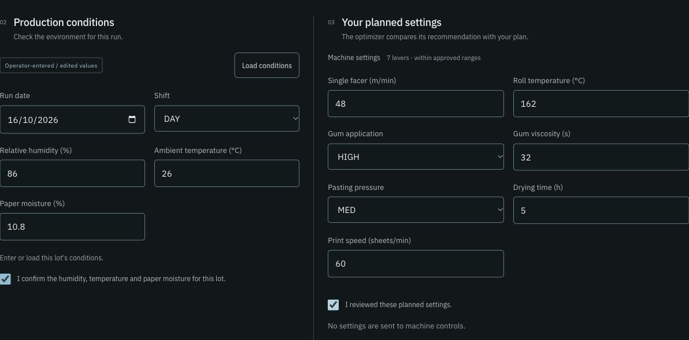

*Authentic application screenshot from the submitted deck. Rendered locally using retained reference responses, not a fresh cloud execution at screenshot time.*

### 3.2 Defect Check: investigation, not unattended inspection

This workspace has two supporting modes:

**Historical Evidence** retrieves comparable source-history cases and context for investigating conditions and defects. Its value is to give operators a structured record to inspect, not to claim a causal laboratory conclusion from a correlation.

**Photo Diagnosis** operates on **ten approved photo IDs** in the demonstration scope. Historical classification labels matched seven out of ten images. This small approved-set result is **not calibrated industrial inspection accuracy**. The prototype does not promise arbitrary photo uploads or a working machine-vision camera line.

### 3.3 Impact: modeled evaluation

Impact displays historical and held-out modeled summaries, not verified monthly factory savings. It is a way to explore estimated trade-offs and the input assumptions behind them. No annualized profit figure or generalized percent reduction is supported by the current evidence.

### 3.4 Why these workspaces are separate

New Lot answers **“What should we prepare and approve for this order?”** Defect Check answers **“What supporting cases or photo clues are available to investigate?”** Impact answers **“What do the modeled comparisons and history suggest across a wider set?”** Keeping these distinct makes the limits of each output easier to understand.

## 4. Example: one reference lot, one bounded comparison

The project presents a particular **reference case PKBX0041**, a recycled **5-ply BC** board with **1,300 boxes** and manually confirmed conditions. The optimizer compared an entered setup with a recommended setup, while leaving specified other settings unchanged.

| Reference measure | Entered setup | Recommended setup | Interpretation |
|---|---:|---:|---|
| Modeled scrap mass | 100.4 kg | 83.0 kg | 17.4 kg lower estimated scrap mass |
| Modeled scrap cost | ₹5,351 | ₹4,426 | ₹925 lower modeled scrap cost |
| Roll temperature | 162°C | 170°C | One proposed setting change |
| Gum application | HIGH | MEDIUM | One proposed setting change |
| Gum viscosity | 32s | 35s | One proposed setting change |

The displayed reference compares **three setting changes**, within the configured maximum. Other reference settings, including speed, pressure and drying as documented in the deck, are unchanged. The quantitative example is deliberately scoped: it is a **modeled reference result**, not a real production trial, audited cost saving, or proof that these settings are universally correct.

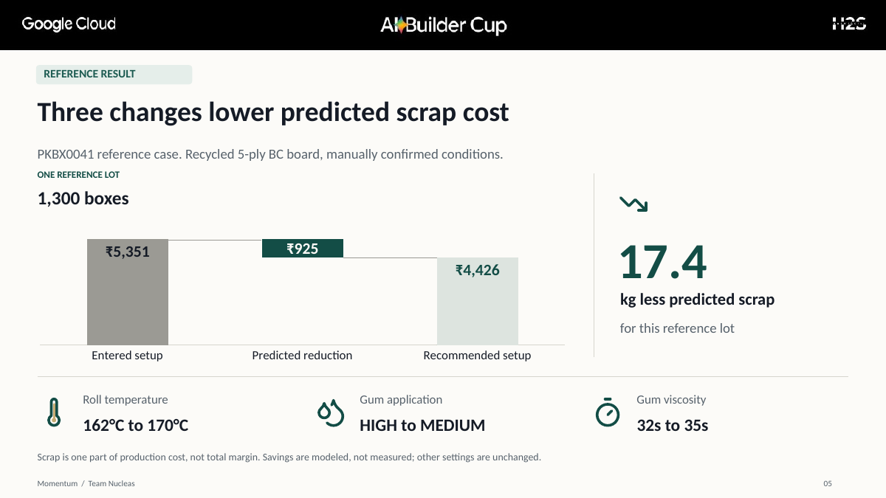

### What this result does and does not prove

The result **illustrates that the system can score alternatives under constraints** and produce an interpretable candidate. It does not mean all settings are optimal on a real factory line. Before using these recommendations operationally, the operator must verify machine-specific safe ranges and the plant must compare actual outcomes against an appropriate baseline.

The bigger commercial opportunity lies in avoiding controllable production costs on **sellable output**, not only scrap. That opportunity is the reason for building Momentum, but the reference case does not quantify it in full.

## 5. AI and numerical intelligence: what each component does

### 5.1 Vertex AI Gemini: language, extraction and explanation

Gemini is used to process supported PO inputs, structure extracted information, explain the chosen recommendation using supplied data, and support limited approved-image classification. The slide-level technology snapshot records **six Gemini calls** for the referenced demonstration. Gemini does not directly choose unconstrained production settings or exercise final approval authority.

The design separates language understanding from numerical truth. Structured extraction needs verification against the actual input and catalog. Narrative explanation is checked against supplied evidence and should not introduce unsupported financial or causal claims.

### 5.2 BigQuery ML: five modeled defect risks

The reference model family estimates risks associated with:

- **Warp:** board shape distortion or undesirable curvature.
- **Delamination:** loss of bond between layers.
- **Strength:** inadequate modeled strength-related characteristics.
- **Print:** printing-quality issues.
- **Crack:** cracking-related behavior, with a documented low-confidence monsoon limitation.

These categories represent **model scope**. They are not an observed distribution of defects at the factory. The source system's historical training table is a modeled production history derived from a real item master, not a measurement collection from installed sensors.

### 5.3 Bounded setting comparison

The recorded reference optimizer uses a finite BigQuery SQL candidate search, evaluating **8,640 candidate combinations** in the example grid, with **at most three changes** allowed. The scoring takes predicted scrap cost and a heuristic slowdown allowance into account. The presence of a numeric objective and a bounded search is useful engineering evidence, but it does not establish a global optimum across the entire manufacturing operation.

The five risk outcomes can conflict. In the reference slide, modeled strength risk increases slightly by **0.078 percentage points** while the overall modeled cost objective improves. A valid explanation must reveal that trade-off instead of claiming every defect risk improves at once.

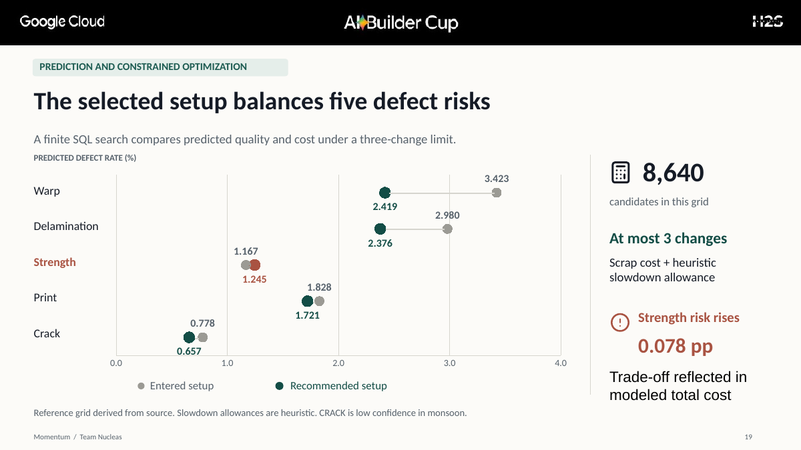

### 5.4 Explanation with inspectable context

The reference WARP explanation exposes statistical attribution and comparable historical records. The deck shows example contributions including **humidity +0.751 percentage points**, **drying +0.162**, and **gum −0.137** to the modeled WARP contribution. A negative contribution is modeled as lowering that particular risk attribution; it does **not** demonstrate measured adhesive consumption or automatically prove causation.

The application can supply up to five comparable source-history records for context, and it distinguishes numbers, reported drivers and causality language. A reviewer can trace the narrative to evidence more readily than if Gemini were free to invent an explanation.

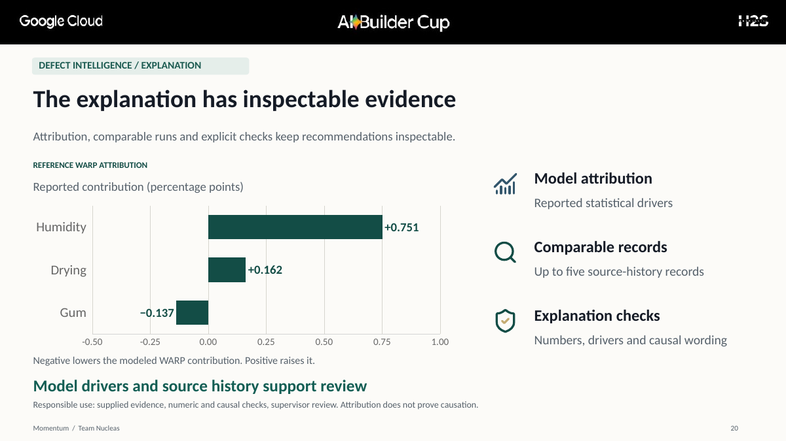

### 5.5 What the system is not

Momentum is **not** an unrestricted chatbot that decides factory settings from natural-language prompts alone. It is **not** an autonomous factory controller or a complete enterprise resource planning system. The demonstrated numerical search is narrower than whole-plant, finite-capacity production scheduling. It is an AI-assisted preparation and review workflow with defined service responsibilities and explicit operating limits.

## 6. Engineering architecture

Momentum is implemented as a web application on **Google Cloud Run**, using **Node.js** and **Hono** for server workflow logic. Its architecture assigns distinct responsibilities to managed services instead of asking one model to handle everything.

| Component | Role in the recorded application | Boundary |
|---|---|---|
| Cloud Run | Hosts the web application and service workflow | Maximum two instances in the documented deployment |
| Vertex AI Gemini | Approved PO extraction, grounded explanation, supported photo task | Provider attempts are metered and bounded |
| BigQuery | 117-item catalog, modeled history, evidence, DRAFTs, audit, numerical SQL | Stored data must not be confused with observed production outcomes |
| BigQuery ML | Five defect models and evaluated model resources | Predictive fit is not established on measured factory outcomes |
| Cloud Storage | Approved inputs, photo objects and PDF job cards | Application controls restrict accepted inputs |
| Firestore | Shared Gemini attempt counter | 100 attempted calls per Asia/Kolkata day in documented prototype quota |
| Secret Manager | Provisions demo-session signing key | Demo session is not enterprise identity verification |
| Pub/Sub | Separately tested simulated ingestion into BigQuery | No physical sensor or camera integration |
| Cloud Build / Artifact Registry / Docker | Build and delivery infrastructure | Deployment mechanics, not a plant-performance metric |
| Cloud Logging | Operational logging | Does not independently establish security certification |
| Zod / PDFKit / Playwright / Node test runner | Schema validation, PDF generation, UI and programmatic testing | Checks are scoped to implemented test cases |
| Gemini TTS in Vertex AI Studio | More than two minutes of narration for the demo video | **Demo-production tool only**, not Momentum runtime |

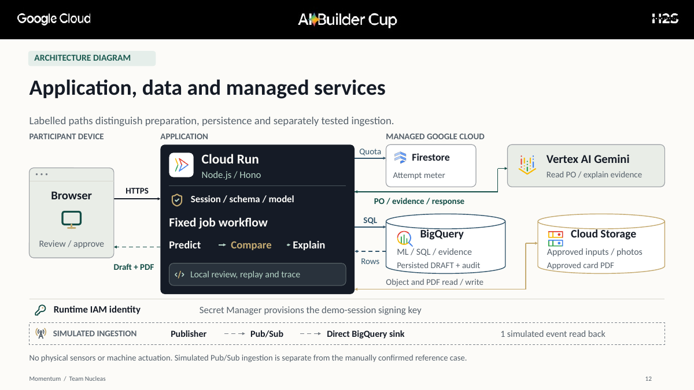

### 6.1 Request and approval phases

The technical sequence in the deck shows the preparation path: review an approved order, store the input, reserve a provider attempt, call Gemini, resolve a catalog item, obtain the reviewed fields, prepare a job, run predictions and comparisons, reserve the explanation attempt, generate the supplied-evidence explanation, persist the matching draft, and read it back. Approval and PDF retrieval are a **separate lifecycle**.

That separation matters. Text generation alone is not permission to release a manufacturing instruction. The application requires a persisted draft and an explicit approval state before returning a stored approved PDF.

### 6.2 What the usage counts mean

The technologies slide provides one measured demonstration snapshot, including **six Gemini calls**, **30 BigQuery queries**, roughly **200 MiB scanned**, **five BigQuery ML models**, one live Cloud Run service, a **17 KB** stored PDF job card, **8 / 100** counted Gemini calls at the captured time, and one verified simulated Pub/Sub event. These figures describe **activity during a particular demonstration**, not guaranteed ongoing throughput, scalability or accuracy.

The stored reference PDF was **16,994 bytes**, consistent with the rounded 17 KB presentation label.

### 6.3 Why the implementation uses bounded responsibilities

Gemini is useful for messy language and readable explanations; BigQuery ML and SQL are used for repeatable numeric outputs; application validation and state transitions enforce the review boundary; managed storage preserves approved results. The combined system gives a technical judge specific components and evidence to inspect. It is more constrained than an LLM-only demonstration, although engineering quality still depends on actual tests and operational verification.

## 7. Responsible use, controls and what is not claimed

Momentum handles inputs and recommendations that could affect physical manufacturing operations. The prototype therefore treats **data confirmation, bounded decisions and human approval** as essential product behavior, not merely a legal disclaimer.

**Documented controls:** approved-input allowlists, TEST-only writes, request-size checks, structured validation, demo-session ownership, same-origin mutation checks, provider-attempt metering, an approval lifecycle, audit records and durable card retrieval. These are described in the public repository documentation; they are **not** equivalent to an independent security penetration test or certified access-control deployment.

**Human-in-the-loop boundary:** Operators confirm source details and conditions; supervisors authorize release of the reviewed card. The software does not issue commands to industrial controllers or actuate machines.

**Uncertainty and explanation:** Numerical outputs are modeled estimates. Correlations and attribution do not prove cause-and-effect. The prototype discloses low-confidence CRACK prediction in monsoon conditions. The system must not imply that human approval converts inaccurate data into accurate data.

**Identity boundary:** The deployed demo uses a selected application-session approach. The repository explicitly states that this is not independently verified enterprise identity. Firebase is described as a separate future role-based access direction, not something the current demo depends upon for verified human identity.

**Privacy boundary:** The public knowledge bank intentionally excludes personal factory production orders, plant identity, credentials, environment variables and operational secrets. Publishing a source repository and demo must not be interpreted as permission to publish proprietary customer records.

**Runtime and cost:** Cloud Run is configured with at most two instances, and Gemini calls have a shared attempted-call limit of 100 per Asia/Kolkata day. Failed or ambiguous provider attempts count. A ₹5,000 budget notification is an alert, **not** an automatic spending cap. Users should not interpret a displayed counter as an SLA.

**Durability limits:** Approved jobs and PDF cards persist, but PO-review, trace and coordination state can be process-local. Cross-instance replay can require extraction again; the current documentation does not claim global exactly-once processing.

## 8. Testing and performance evidence

### 8.1 Application workflow evidence

The recorded reference acceptance on **16 October 2026** documents **43 passing checks and two retained failures** for the private reference journey. The test path reached approved-card creation and independent retrieval of the stored approval record and PDF. A separate public release suite showed **27/27 checks passing** around navigation, evidence views, browser paths and refusal controls. The retained failures included a harness error and a cross-instance replay issue.

These outcomes verify aspects of **application behavior**, not predictive-model accuracy. A passing UI or PDF retrieval test is not evidence that a defect-risk model will perform well on real factory production.

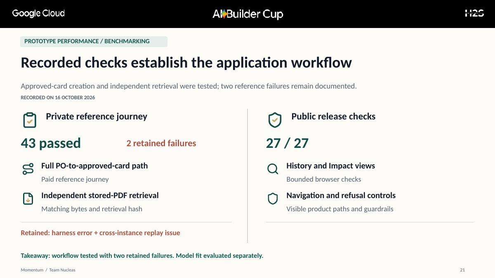

### 8.2 Model evaluation: internal split and separate holdout

The repository retains acceptance thresholds for five models and records an internal split where R² values meet the stored thresholds. However, **the original internal split's sample count and exact membership are no longer recoverable**, and therefore those internal metrics do not provide fully reconstructible validation evidence.

A separate, independently counted **September 2026 holdout of 219 modeled lots** produced the following R² results:

| Modeled defect | Recorded R² threshold | September holdout R² | Clears threshold? |
|---|---:|---:|---|
| WARP | 0.60 | 0.4021 | No |
| DELAM | 0.60 | 0.5003 | No |
| STRENGTH | 0.45 | 0.2971 | No |
| PRINT | 0.60 | 0.6102 | **Yes** |
| CRACK | 0.30 | −0.0136 | No |

R² is a regression-fit measure; it is **not** a direct percentage of correct defect classifications. A negative R² means worse fit than a baseline that predicts the holdout's mean. The September holdout clears only PRINT's stated threshold; CRACK has negative R² and is specifically disclosed as low confidence in monsoon conditions.

The founders accepted the existing models **for a supervised hackathon prototype under a documented exception**, without claiming that this acceptance proves autonomous industrial readiness. This is an engineering boundary, not a reason to hide adverse observations.

### 8.3 Why the submitted slide summarizes readiness

The presentation groups evidence into **what works, what was tested, and what comes next** so a reviewer can find the operative conclusion quickly. The detailed R² values remain here and in the public model-acceptance configuration. This keeps the main slide readable without withholding the technical data from anyone who needs it.

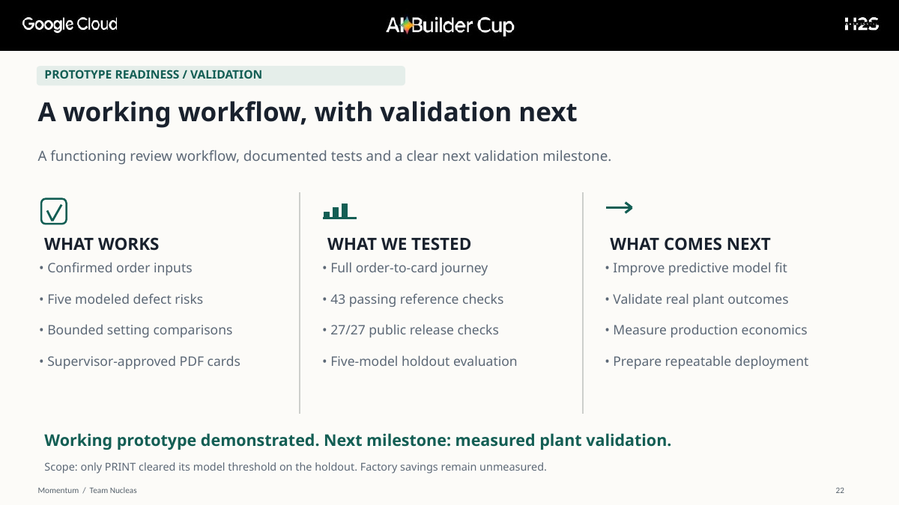

### 8.4 Evidence status summary

| Statement | Status | Appropriate interpretation |
|---|---|---|
| Application has a working supervised preparation workflow | Demonstrated in recorded tests | Functionality scoped to recorded cases |
| Approved PDF card and record were retrieved | Demonstrated | Persistence and retrieval shown in reference run |
| Five defect-risk models exist | Implemented | Their real-world predictive utility is not established |
| ₹925 less scrap cost on reference lot | **Modeled** | Not realized or audited factory savings |
| One simulated Pub/Sub event was read back | Demonstrated in isolated test | No live industrial telemetry claimed |
| Photo classification matched 7/10 approved examples | Recorded limited test | Not calibrated inspection accuracy |
| Physical sensor streaming or machine actuation | Not implemented | Future direction only |
| Measured reduction in production costs | Not established | Requires plant trials with actual records |

## 9. What differentiates Momentum

This section describes a **workflow distinction**, not a measured head-to-head victory over a named competitor.

| Ordinary preparation challenge | Momentum's demonstrated response |
|---|---|
| Order details may be scattered or ambiguous | Structured extraction plus operator review and catalog matching |
| Settings may be chosen from remembered practice alone | Candidate comparison across modeled risks and cost assumptions |
| A cost improvement may worsen another quality dimension | Explicit bounded trade-off under a three-change limit |
| Recommendations can be difficult to explain | Supplied-evidence explanation with inspectable model context |
| A recommendation can look like an authorization | Separate DRAFT and APPROVED states with reviewer intervention |
| Final settings can be lost in transient discussions | Stored, retrievable approved PDF job card |

The distinctive proposition is not “we use Gemini.” It is the **chain from confirmed industrial context to constrained comparison, explainable review and approved durable instruction**. This is a credible workflow USP for the prototype. It is not evidence that no manufacturing-planning product elsewhere has similar features.

### A useful scenario for technical evaluation

A lower modeled cost setting can increase a quality risk or violate an allowed change bound. Momentum's numeric comparison should make the competing values visible rather than announce an unexplained “best” option. The reference example already shows a positive model-risk trade-off in STRENGTH while modeled total cost improves. A broader autonomous refusal system should not be claimed unless its exact implementation and test evidence are provided.

## 10. Sustainability and social usefulness

Momentum is entered under Sustainability while addressing the manufacturing intelligent-operations challenge. The plausible environmental mechanism is **improved resource use per accepted output**, potentially reducing unnecessary material consumption, rework and avoidable operating time. But those benefits are **hypotheses**, not established outcomes from the prototype.

A valid future impact evaluation should measure material consumed per accepted box or order, accepted-unit yield, rework, energy consumption where metered, production duration, actual cost per accepted order, and quality acceptance. Any claims about kilograms of avoided waste or carbon impacts should be calculated only from observed data and documented conversion assumptions.

The social and operational contribution is better information for workers and supervisors, not removing human expertise. The product should make reasons and uncertainty visible so human decisions remain accountable.

## 11. Roadmap and scalability

The public roadmap is **ordered by validation**, not by speculative dates or adoption claims.

**Milestone 1 — Validate one plant:** Compare modeled recommendations with measured outcomes, gather operator feedback, improve model calibration and assess whether cost improvements preserve quality and throughput.

**Milestone 2 — Strengthen operating controls:** Revisit process-local state, cross-instance recovery, independently verified identity, role-based permissions and durable auditability where appropriate.

**Milestone 3 — Repeat for another line or plant:** Define a configuration contract for each factory's machine ranges, materials, catalog mappings, data quality, operational constraints and required review roles. Demonstrate repeatability before claiming multi-site readiness.

**Milestone 4 — Broaden functionality carefully:** Additional languages, workflow assistant, human escalation and supported monitoring integrations can improve usability if backed by implementation and validation.

**Milestone 5 — Consider adjacent manufacturing sectors:** Only after the planning boundary, data contracts and operator-validation process are repeatable. A corrugated prototype is not automatically a universal industrial optimizer.

Scalability has two distinct meanings. **Cloud service scalability** concerns infrastructure handling more users or calls. **Industrial rollout scalability** concerns onboarding a new factory with trustworthy data and local constraints. The current deck demonstrates a managed cloud implementation and outlines, but does not yet prove, the latter.

## 12. Screenshots and visual evidence gallery

All screenshots below come from the submitted presentation. Their source descriptions and caveats are kept in the captions. They should never be relabeled as measured factory outcomes.

### Confirm production inputs before analysis

*The operator reviews production conditions and seven planned settings. Locally rendered application UI with retained reference responses.*

### Examine five modeled risks

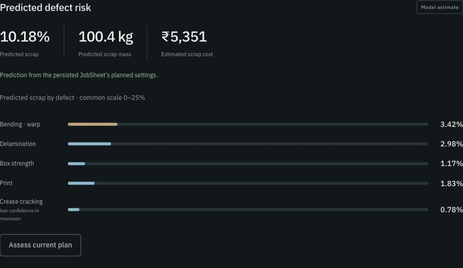

*Model estimates, not a measured defect distribution.*

### Compare proposed setup and evidence

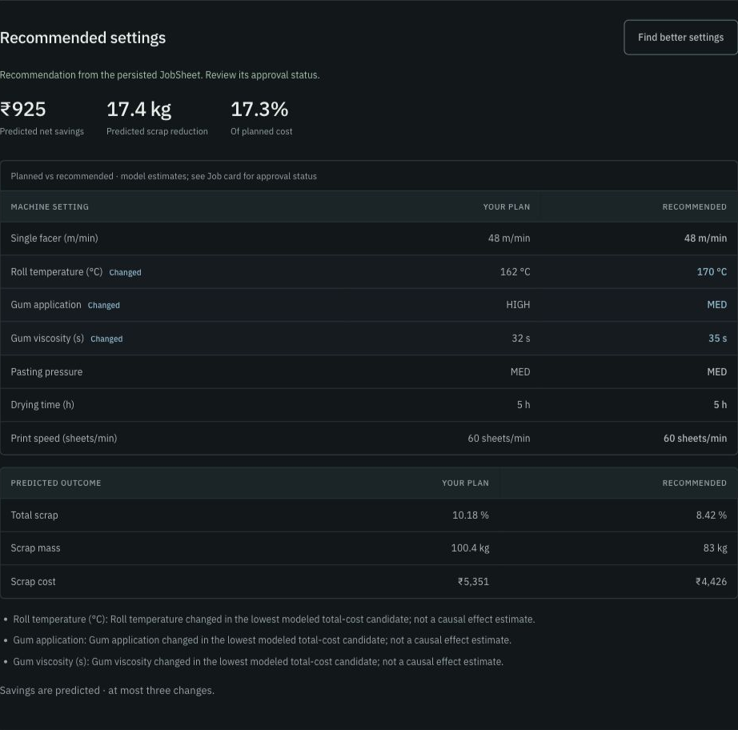

*Bounded proposed settings and review context. No autonomous machinery control.*

### Persist a draft separately from approval

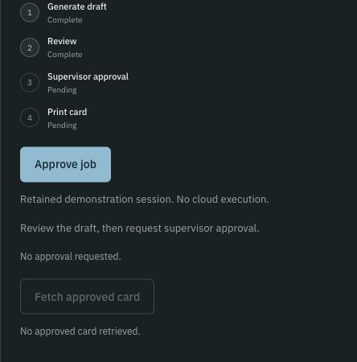

*A persisted DRAFT is not an approved manufacturing instruction.*

### Approve and retrieve the final card

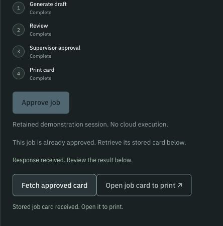

*The approved state is part of a controlled reference workflow.*

### Independently verify the recorded output

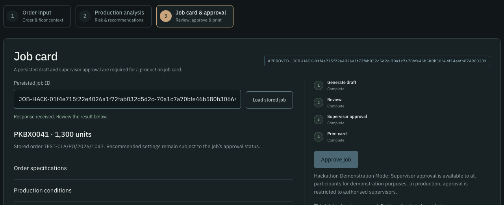

*Reference journey: a two-page, 16,994-byte card with matching retrieval hash.*

## 13. Frequently asked questions

### Why call it industrial intelligence rather than a defect detector?
Because the product begins before the run, connects order context and settings, compares modeled quality/cost trade-offs, and ends with an approved instruction. Defect-related models are components, not the entire workflow.

### What does “pre-run” mean?
The planning and review stage before a production lot is executed. Momentum currently recommends and records decisions; it does not actuate machinery.

### Why corrugated manufacturing?
The team has direct practical exposure through Om and access to a real product catalog, allowing a better-bounded initial case than a generic cross-industry AI idea.

### Is the site describing a deployed product or just a mockup?
A Cloud Run application and controlled approval/retrieval journey are documented. Some screenshots are locally rendered using retained responses. Model predictions and factory value are not independently validated.

### Are the 117 catalog items real?
The project documentation says yes: the item master comes from a real plant. The history used for training and analysis is modeled, not actual long-term recorded production telemetry.

### Does Gemini run the optimizer?
No. Gemini handles structured-language tasks and grounded explanation. BigQuery ML and SQL supply numerical prediction and candidate comparison. Application code manages validation and approval states.

### Why not just ask a general-purpose LLM for machine settings?
An unconstrained answer cannot be assumed to respect machine ranges, catalog facts, numerical trade-offs, source uncertainty or approval semantics. Momentum uses more explicit structure, although the prototype still requires independent validation.

### Is the optimizer OR-Tools CP-SAT?
The documented **current** reference run uses a finite **BigQuery SQL candidate search** with explicit change limits. Do not advertise CP-SAT as the production method unless current code and evidence show that implementation.

### What is the three-change constraint?
The reference optimizer is permitted to recommend at most three differences from the entered setup. This bounds the scope of a proposed intervention, but it does not prove physical safety or a global optimum.

### What defects are modeled?
WARP, DELAM, STRENGTH, PRINT and CRACK.

### Are the model outputs accurate enough for live autonomous production?
No such assurance is supported. The holdout misses the recorded threshold for four of five models; the system is a supervised prototype.

### What does a negative CRACK R² imply?
On the reported independent holdout it fits worse than the mean-prediction baseline. This is why confidence is explicitly limited in monsoon context.

### Why do the internal split and September holdout differ?
They are different evaluation samples. Internal split metrics met thresholds, but original split membership/counts are unrecoverable. The later independent September holdout is counted and more cautionary.

### Does the ₹925 figure represent money the factory actually saved?
No. It is a **modeled reference-lot scrap-cost reduction**, not an observed monetary gain.

### Why discuss margins if the quantified result is scrap?
The real business problem includes excess manufacturing cost on sellable boxes. The prototype currently illustrates only part of that economic opportunity, with larger measures still requiring field data.

### What if a cheaper setting slightly increases one modeled quality risk?
That trade-off should be visible and considered before approval. The reference strength prediction increases by 0.078 percentage points while modeled total cost improves.

### Are explanations causal?
No. Statistical attribution and historical comparisons describe model associations; they do not independently prove causal relationships.

### Who has final authority?
A supervisor in the reviewed job-card workflow. The demo-session mechanism is not equivalent to verified corporate identity.

### Can an operator edit an ambiguous purchase order?
The workflow returns to review and confirmation rather than treating ambiguous extraction as unquestioned truth.

### Is every PO upload supported?
No. The hackathon prototype restricts demo inputs to approved purchase-order fixtures and validates against allowlists.

### What does DRAFT mean?
A persisted recommendation awaiting review. It is not released as an approved manufacturing instruction.

### What does APPROVED mean?
The application's recorded approval state, after review, from which the stored approved PDF can be retrieved.

### Are approved PDFs durable?
The reference workflow independently read back stored approved records and the PDF object. This is scoped evidence of persistence; cross-instance exactly-once handling is not claimed.

### What happens if Cloud Run switches instances mid-workflow?
Some review and trace state is process-local and may need reconstruction or re-extraction. The repository explicitly records this limitation.

### Is there live machine telemetry?
No. The demonstrated Pub/Sub event is a separate simulation and not physical sensor integration.

### Can Momentum diagnose any uploaded factory photo?
No. The photo experience is limited to ten approved IDs; seven historical labels matched. This is not calibrated inspection accuracy.

### Are annual savings shown?
No verified annualized factory savings are established. The Impact workspace describes modeled comparisons.

### What about environmental benefits?
Better resource efficiency is a plausible objective, but measured material, energy and emissions outcomes are future validation tasks.

### Why Google Cloud?
It separates language AI, structured data, numeric models, application orchestration, metering and durable files into identifiable managed components. This makes the integration and evidence visible to technical reviewers.

### How many Gemini calls can the demo make?
The documented quota is 100 attempted calls per Asia/Kolkata day, with shared Firestore metering. Failed or ambiguous attempts count.

### Does the ₹5,000 budget alert guarantee that spending stops there?
No. It is a notification, not a hard cap.

### Why is Gemini TTS listed under tools?
It was used to generate demo-video narration (more than two minutes); it is not a runtime dependency of Momentum.

### How does this differ from an ERP or MES?
Momentum is a narrow pre-run preparation and supervisor-approval prototype. It is not presented as a replacement for comprehensive enterprise planning, execution or industrial controls.

### Does passing 43 checks prove model accuracy?
No. The recorded checks concern the software workflow. Predictive validation is a separate question.

### Why were two failures retained in the reporting?
The accepted test evidence recorded a harness error and cross-instance replay limitation. The project documents them rather than claiming a clean production-readiness result.

### Is the demo using private plant records?
The published references use approved inputs and a real item master underlying modeled history. The public site should not expose private customer orders or sensitive plant details.

### What evidence should judges inspect first?
Start with Slides 3–6 for problem and solution, Slides 12–13 for architecture and tools, Slides 15–18 for the application, Slides 19–22 for numeric reasoning and tests, then the public repository's README and model-acceptance configuration.

### What happens after the hackathon?
The next credible milestone is comparison against measured production outcomes and stronger predictive validation. Further controls, identity, sensor integration and multi-plant deployment remain future work.

## 14. Glossary

| Term | Meaning in this knowledge bank |
|---|---|
| PO | Purchase order, the approved source document entering the reference workflow |
| GSM | Grams per square metre, a paper grammage measure |
| Flute | Corrugated wave profile forming part of the board construction |
| Lot | The order/run context being prepared and reviewed |
| Five risk models | BigQuery ML models for warp, delamination, strength, print and crack |
| R² | Regression-fit statistic, not classification accuracy percentage |
| Modeled | Based on simulated history or mathematical predictions, not direct observed savings |
| Candidate search | Evaluating bounded possible machine-setting combinations under an objective |
| DRAFT | Stored proposal awaiting reviewer approval |
| APPROVED | Recorded approved state enabling retrieval of stored job-card PDF |
| Job card | Reviewed production-preparation instruction artifact |
| Holdout | Evaluation sample not used in the training comparison described |
| Model attribution | A decomposition of reported model contribution, not proof of causality |
| Cloud Run | Google Cloud managed container runtime hosting the prototype application |
| Pub/Sub | Messaging system, used here for a separate simulated ingestion test |
| Human-in-the-loop | Explicit operator input and supervisor authorization in the workflow |

## 15. Source register and evidence links

The following references are public and should remain visible from the published site. Do not replace these links with generic citations or invented bibliography entries.

1. [Momentum public GitHub repository](https://github.com/SiddhantOswal/Momentum) — product overview, implementation boundaries and setup.
2. [Root README](https://github.com/SiddhantOswal/Momentum/blob/main/README.md) — working application, reference case, product scope and safeguards.
3. [Repository guide](https://github.com/SiddhantOswal/Momentum/blob/main/docs/README.md) — deployment, approved samples, testing, lifecycle and model-evidence limitations.
4. [Model acceptance configuration](https://github.com/SiddhantOswal/Momentum/blob/main/config/model-acceptance.json) — exact thresholds, internal evaluation and September holdout, versions and owner exception.
5. [Approved demonstration fixtures](https://github.com/SiddhantOswal/Momentum/tree/main/public/samples) — restricted sample POs, not open-ended customer input.
6. [Deployed Momentum application](https://momentum-514663464609.asia-south1.run.app/) — current public entry point; user sessions and provider quotas may apply.
7. **Momentum AI Builder Cup pitch:** link the approved public PDF here after it has been published. No public presentation URL was supplied when this reference was prepared.
8. [Feedback form](https://forms.gle/4NWFdb8USJopqPwV7) — optional project feedback, not an official judging channel.

**Evidence reviewed for this knowledge bank:** Final polished 25-slide presentation; repository root README; `docs/README.md`; `config/model-acceptance.json`; `package.json`; and user-provided context that the team has direct factory access through Om. This content was prepared for technical explanation. It does not constitute an independent plant audit, security assessment or empirical validation study.

**Last content review:** 17 October 2026.  
**Maintained by:** Team Nucleas.  
**Primary reader:** Google Cloud AI Builder Cup judge, engineer, researcher or technically curious visitor.
